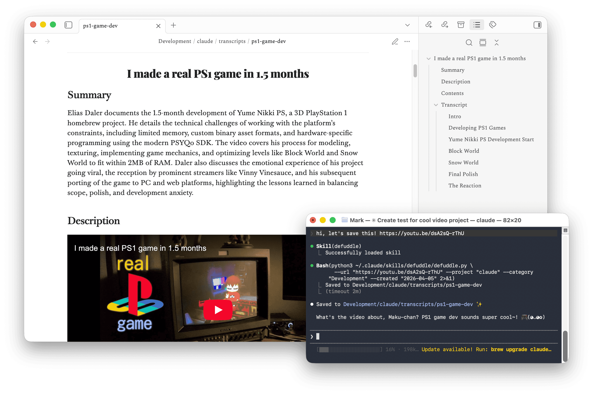

# Defuddle — Claude Code Skill

A token-saving replacement for Claude Code's `WebFetch`. Paste a link and [Defuddle](https://github.com/kepano/defuddle) plus a small Python script turn it into a clean Markdown note **outside** Claude's context, so Claude only reads the finished result, not the ads, menus and raw HTML. Notes can be saved straight to your [Obsidian](https://obsidian.md) vault (or any folder).

Works with:

- **Web pages and docs**, with Wayback Machine / archive.is fallbacks for paywalled or JS-heavy pages
- **YouTube videos**: full transcript with timestamps and chapters
- **Apple Podcasts** episodes (macOS)
- **Academic papers**: DOI, arXiv, SSRN and Academia.edu links
- **PDFs**: any `.pdf` link or a file on your computer

Every note gets an AI summary, tags and an index, and images can be saved locally.



---

## Quick install

**1. Install the tools** (macOS, with [Homebrew](https://brew.sh)):

```bash
brew install defuddle yt-dlp
```

**2. Get the skill:**

```bash
git clone https://github.com/spaceage64/claude-defuddle ~/.claude/skills/defuddle
```

**3. Set where notes are saved:** open `~/.claude/skills/defuddle/defuddle.py` and set `VAULT_PATH` near the top:

```python
VAULT_PATH = '/your/path/to/obsidian/vault'
```

**4. Allow the tools** in `~/.claude/settings.json`:

```json
{
  "permissions": {
    "allow": [
      "Bash(defuddle **)",
      "Bash(yt-dlp *)",
      "Bash(python3 ~/.claude/**)"
    ]
  }
}
```

(`defuddle **` uses a double wildcard because URLs contain `/`, which a single `*` won't match.)

**5. Recommended: add a free Gemini key** for summaries ([get one here](https://aistudio.google.com/apikey)), in `~/.claude/CLAUDE.md`:

```markdown
## API Keys

- **Gemini**: `YOUR_GEMINI_API_KEY_HERE`
```

Without a key, summaries fall back to a separate Claude Haiku process, which uses your Claude usage.

## Usage

Just paste a link into Claude Code:

> "Can you read this? https://example.com/some-article"

> "https://www.youtube.com/watch?v=dsA2sQ-rThU"

> "https://doi.org/10.1145/3706598.3713709"

Claude reads the clean version and asks whether to save it. Tell it a folder name, and the note lands in `{vault}/{folder}/defuddle/`.

---

## More details

<details>
<summary><b>Why it saves tokens</b></summary>

<br>

`WebFetch` puts raw page content (ads, navigation, footers and all) straight into Claude's context. This skill does that work elsewhere:

- **Defuddle** strips pages down to just the article before Claude sees anything
- **yt-dlp** handles YouTube transcripts in a subprocess, so no raw subtitle files end up in context
- **Marker / Datalab** convert PDFs to Markdown outside Claude's context
- **The Python script** does all formatting (frontmatter, tags, timestamps, indexes, images) without Claude reasoning about any of it
- **A separate AI provider** (Gemini, OpenAI, Ollama) writes the summaries, so a full article never has to fit in Claude's context. Gemini's free tier is the default.

Claude's job is just: trigger the skill, get the finished note, save it.

</details>

<details>
<summary><b>Example note</b></summary>

<br>

```
---
tags:
  - project/myproject
  - defuddle/doc
  - python
  - packaging
created: "2026-03-14"
title: "How to publish a Python package"
description: "A step-by-step guide to publishing a Python package to PyPI using modern tooling."
url: "https://example.com/python-packaging"
author: "Jane Smith"
published: "2024-11-01"
site: "example.com"
---

---

# How to publish a Python package

## Summary

A concise AI-generated summary of the article's key points...

## Index

- [[#Setting up your project]]
- [[#Writing pyproject.toml]]
- [[#Publishing to PyPI]]

---

[full article content]
```

</details>

<details>
<summary><b>All requirements and optional tools</b></summary>

<br>

| Tool | Purpose | Install |
|---|---|---|
| [Claude Code](https://claude.ai/code) | Runs the skill | See Claude docs |
| [defuddle](https://github.com/kepano/defuddle) | Extracts clean content from web pages | `brew install defuddle` or `npm install -g defuddle` |
| [yt-dlp](https://github.com/yt-dlp/yt-dlp) | Downloads YouTube transcripts | `brew install yt-dlp` |
| Python 3.9+ | Runs the formatting script | Pre-installed on macOS Ventura+ |
| [Obsidian](https://obsidian.md) | Your note vault (optional) | See Obsidian site |

**AI summaries, tags and descriptions:**

| Tool | Purpose | Install |
|---|---|---|
| Gemini API key | AI enrichment via Google (default) | [aistudio.google.com/apikey](https://aistudio.google.com/apikey), free tier available |
| [Ollama](https://ollama.com) | Local AI, no key needed | `brew install ollama` |

**Papers and PDFs:**

| Tool | Purpose | Install |
|---|---|---|
| [marker-pdf](https://github.com/VikParuchuri/marker) | Local PDF→Markdown (default); version 2 also needs `llama-server` | `pipx install marker-pdf` and `brew install llama.cpp` |
| Datalab API key | Cloud PDF→Markdown fallback | [datalab.to](https://datalab.to): free accounts get $10 in credits (roughly 10–15 cents per paper) |
| poppler | Sharp arXiv PDF figures (200 dpi); reads PDF text for the shadow library check | `brew install poppler` |
| Ghostscript | Renders EPS figures of arXiv papers (skipped with a warning without it) | `brew install ghostscript` |
| [uv](https://docs.astral.sh/uv/) | Runs PyMuPDF in isolation for PDF compression | `brew install uv` |

**Images:**

| Tool | Purpose | Install |
|---|---|---|
| pngquant | Lossy PNG compression (~60–80% smaller) | `brew install pngquant` |
| jpegoptim | JPEG compression (quality ceiling 85) | `brew install jpegoptim` |
| ImageMagick | Converts uncommon image formats on Linux/Windows (macOS uses the built-in `sips`) | `brew install imagemagick` / your package manager |

</details>

<details>
<summary><b>AI providers</b></summary>

<br>

Choose a provider with `AI_LLM` in `defuddle.py`.

**Gemini (default).** Add your key to `~/.claude/CLAUDE.md` as shown in Quick install. The default model is `gemini-3.1-flash-lite`, which is on the free tier; change it with `AI_MODEL`. See the [API pricing overview](https://ai.google.dev/gemini-api/docs/pricing) for free tier eligibility. To go back to the free tier later, just remove your billing info.

**OpenAI or compatible APIs.** Set `AI_LLM = 'openai'` and add your key to `~/.claude/CLAUDE.md`:

```markdown
- **OpenAI**: `YOUR_API_KEY_HERE`
```

Set `AI_BASE_URL` to use any OpenAI-compatible endpoint:

```python
AI_BASE_URL = 'https://api.groq.com/openai/v1'   # Groq
AI_BASE_URL = 'https://zen.opencode.ai/v1'        # OpenCode Zen (free)
AI_BASE_URL = 'https://api.together.xyz/v1'       # Together AI
```

**Ollama (local, no key needed).** Set `AI_LLM` and `AI_MODEL` to any model you have pulled:

```python
AI_LLM   = 'ollama'
AI_MODEL = 'llama3.2'
```

**Claude CLI fallback.** If no API key is found or the provider fails, the skill falls back to the Claude CLI, as a separate process so it doesn't use your current session's context. Set the model with `AI_FALLBACK_MODEL` (defaults to Haiku).

</details>

<details>
<summary><b>Web pages, YouTube and podcasts</b></summary>

<br>

- **Web pages** — ads and clutter are stripped, and the note gets an AI summary, a heading index and frontmatter. JS-rendered or paywalled pages fall back to the Wayback Machine or archive.is.
- **YouTube transcripts** — manual captions first (better quality), then auto-generated ones. Duplicated lines from rolling captions are removed automatically.
- **YouTube chapters** — the video's own chapter markers are used; without them, the AI adds logical chapter breaks.
- **Videos without subtitles** — the note still gets the title, channel and full description, with "No subtitles available for this video." in place of the transcript. YouTube links never go through the archive fallbacks.
- **Apple Podcasts** — same as YouTube, using the TTML transcript the macOS Podcasts app stores. macOS only; no other podcast platforms for now.
- **Tags** — hashtags in YouTube descriptions and keywords in paper abstracts become tags, and the AI adds content-based tags.

</details>

<details>
<summary><b>Academic papers and PDFs</b></summary>

<br>

Supported sources:

- **DOI** — `https://doi.org/10.xxxx/...`
- **arXiv** — `https://arxiv.org/abs/...`
- **SSRN** — `https://papers.ssrn.com/sol3/papers.cfm?abstract_id=...`
- **Academia.edu** — `https://www.academia.edu/{id}/...` (public PDF if available, otherwise the shadow library via DOI)
- **Any `.pdf` link** — the first page is scanned for a DOI and sent through the paper pipeline if one is found
- **A local file** — pass the path to a PDF on your computer

Papers get a note with the abstract, keywords as tags and the bibliography. For DOI and arXiv papers, the skill:

1. Tries the arXiv LaTeX source first (best quality)
2. Falls back to local [Marker](https://github.com/VikParuchuri/marker) for PDF→Markdown
3. Falls back to the Datalab API if Marker isn't installed
4. Optionally opens a shadow library in your browser for paywalled papers (see below)

The PDF processor order is set by `PDF_PROCESSOR` (default `local_first`). To use Datalab, add your key to `~/.claude/CLAUDE.md`:

```markdown
- **Datalab**: `YOUR_DATALAB_API_KEY_HERE`
```

**Marker quality.** Local `marker` has two settings, chosen with `MARKER_PRECISE`:

| Setting | What it does | Best for |
|---|---|---|
| `MARKER_PRECISE = False` (default) | Normal conversion: about a minute or two per paper | Papers with little math |
| `MARKER_PRECISE = True` | Runs OCR on every page and has the AI provider re-read inline math: roughly 5–15 minutes per paper | Math-heavy papers: in normal mode, inline math like `$X_t$` can come out as broken text like `*Xt*` |

Times are from an Apple Silicon Mac. The setting has no effect on Datalab, or on arXiv papers converted from their LaTeX source.

**Keeping the PDF.** With `--keep-pdf`, the original PDF is saved next to the note under the same name. When `ENABLE_PDF_COMPRESSION` is on (the default) and [uv](https://docs.astral.sh/uv/) is installed, it is compressed with PyMuPDF: images above 160 dpi go to 150 dpi, fonts are trimmed, and forms and protected files are left alone.

**Paper figures.** For arXiv papers converted from LaTeX, figures are collected from every subfolder (e.g. `figures/`) and matched by path, file name or name without extension (as `\includegraphics` often omits it). PDF and EPS figures are rendered at 200 dpi and saved as PNG or JPG; figures made of several sub-figures keep all of them.

**Shadow library.** Set `SHADOW_BASE_URL` to use one for paywalled papers (`''` disables it). It needs to support this URL format: `https://example.domain/10.1103/PhysRevB.57.6107`

```python
SHADOW_BASE_URL = 'https://your-shadow-library.example'
DOWNLOADS_DIR   = ''    # '' = system default; set a path if your browser saves elsewhere
SHADOW_WAIT     = 600   # seconds to wait for the PDF
```

Shadow libraries usually sit behind a browser check (e.g. DDoS-Guard) that scripts can't pass, so defuddle opens the paper's page in your browser and watches your downloads folder: save the PDF there and processing continues on its own. Only a PDF whose first pages show the paper's DOI (or, failing that, its title) is used, so downloads of other papers are skipped and several runs can wait at once. Text is read with `pdftotext` (poppler), PyMuPDF via `uv`, or a raw byte scan as a last resort. The PDF stays in your downloads folder.

The default downloads folder is `~/Downloads` on macOS, the Downloads known folder on Windows (also when it was moved), and `xdg-user-dir DOWNLOAD` on Linux (falling back to `~/Downloads`). Partial downloads (`.crdownload`, `.part`, `.download`) are ignored until they finish.

</details>

<details>
<summary><b>Images</b></summary>

<br>

With `ENABLE_IMAGES = True`, images are downloaded into an `img/` folder next to the note, and compressed with `pngquant` and `jpegoptim` when `ENABLE_IMAGE_COMPRESSION` is on. Invalid responses (auth errors, HTML pages served as images) are detected, and the original URL is kept instead.

Each image gets its type from its contents, not its URL, so a JPEG served as `.jpeg`, `.jfif`, `.PNG` or without any extension is saved as `.jpg`. JPG, PNG, SVG and GIF keep their format. WebP, AVIF, BMP, TIFF, HEIC/HEIF, JPEG XL, JPEG 2000, ICO and PSD are converted: images with transparency become PNG; otherwise both a PNG and a JPG are made and the smaller one is kept (PNG wins for screenshots, diagrams and text, JPG for photos). Without a converter (`sips` on macOS, ImageMagick elsewhere) such images are kept as they are, with a warning. `finalize_image(path)` does all of this for a single file and can be used on its own.

</details>

<details>
<summary><b>How the skill is triggered</b></summary>

<br>

The `description` field in `SKILL.md` tells Claude when to use it:

```
TRIGGER when: user provides any URL to a webpage, documentation, article, blog post,
or any standard web content.
DO NOT use WebFetch for these — use defuddle.
```

You can reinforce this in your own `~/.claude/CLAUDE.md`:

```markdown
## Tools

- **Never use WebFetch for standard web pages** — always use the `defuddle` skill instead.
```

</details>

<details>
<summary><b>Platform notes</b></summary>

<br>

- Designed and tested on macOS. Linux should work for articles, YouTube and papers (all dependencies are available), but it's untested. Windows may work with Claude Code for Windows and the tools installed, also untested. Apple Podcasts is macOS only.
- Formatting is tuned for Obsidian and may look slightly different in other Markdown apps.

</details>
