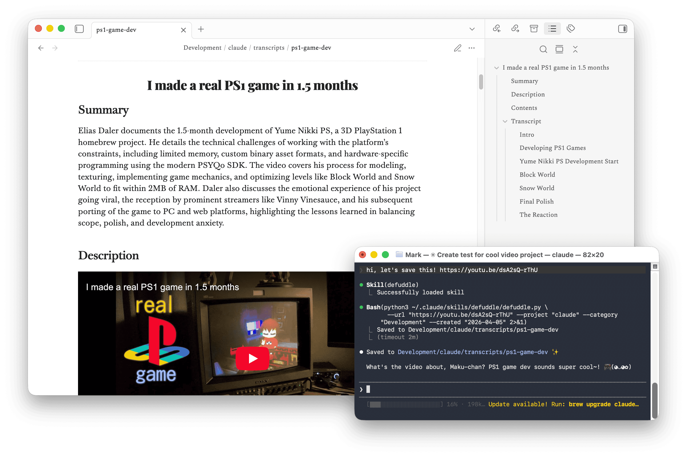

# Defuddle — Claude Code Skill

A token-saving replacement for Claude Code's `WebFetch`. Paste a link and [Defuddle](https://github.com/kepano/defuddle) plus a small Python script turn it into a clean Markdown note **outside** Claude's context, so Claude only reads the finished result, not the ads, menus and raw HTML. Notes can be saved straight to your [Obsidian](https://obsidian.md) vault (or any folder).

Works with:

- **Web pages and docs**, with Wayback Machine, archive.is, Arquivo.pt and Common Crawl fallbacks for paywalled or JS-heavy pages
- **YouTube videos**: full transcript with timestamps and chapters
- **Apple Podcasts** episodes (macOS)
- **Academic papers**: DOIs (as a link or plain, e.g. `10.17487/RFC6298` or `doi:10.17487/RFC6298`), arXiv, SSRN and Academia.edu links, article links from publishers like ScienceDirect, Wiley and Springer, PubMed, NBER, university repositories and RFCs
- **PDFs**: any `.pdf` link or a file on your computer
- **Books**: PDFs with an ISBN and 50+ pages, or 100+ pages with chapters, are saved as books: headings from the PDF's bookmarks and printed table of contents, a linked Contents table with page numbers, the back-of-book index as a nested list, code listings repaired from the PDF, blank pages left out, and author, publisher, year and ISBN-13: the ISBN is read in any printed form (also with OCR slips like `978 l l 07…`) and looked up in Open Library, the Library of Congress and Google Books, and what is still missing is read from the title and copyright pages by the AI model (kept only when the PDF shows it). Books are named like papers, `{author}-{a few words}` (an organisation's first word when no person is named). To override the detection, pass `--as doc`, `--as paper` or `--as book`

Every note gets an AI summary, tags and an index, and images can be saved locally.



---

## Quick install

**1. Install the tools** (macOS, with [Homebrew](https://brew.sh)):

```bash
brew install defuddle yt-dlp
```

**2. Get the skill:**

```bash
git clone https://github.com/spaceage64/claude-defuddle ~/.claude/skills/defuddle
```

**3. Set where notes are saved:** open `~/.claude/skills/defuddle/defuddle.py` and set `VAULT_PATH` near the top:

```python
VAULT_PATH = '/your/path/to/obsidian/vault'
```

**4. Allow the tools** in `~/.claude/settings.json`:

```json
{
  "permissions": {
    "allow": [
      "Bash(defuddle **)",
      "Bash(yt-dlp *)",
      "Bash(python3 ~/.claude/**)"
    ]
  }
}
```

(`defuddle **` uses a double wildcard because URLs contain `/`, which a single `*` won't match.)

**5. Recommended: add a free Gemini key** for summaries ([get one here](https://aistudio.google.com/apikey)). Either put it in the **API keys** section at the top of the settings in `defuddle.py`:

```python
GEMINI_API_KEY = 'YOUR_GEMINI_API_KEY_HERE'
```

or keep your keys in a separate file and point `KEYS_FILE` at it (e.g. `KEYS_FILE = '~/.config/claude/keys.env'`, made private with `chmod 600`), one per line:

```bash
GEMINI_API_KEY=YOUR_GEMINI_API_KEY_HERE
```

A key left `''` in the script is taken from an environment variable with the same name (`GEMINI_API_KEY`, `OPENAI_API_KEY`, `DATALAB_API_KEY`, `INTERNET_ARCHIVE_API_KEY`), then from `KEYS_FILE`. Keys in `~/.claude/CLAUDE.md` (`- **Gemini**: \`your-key\``) still work too, but CLAUDE.md is loaded into every Claude conversation, so the script or a keys file is safer.

Without a key, summaries fall back to a separate Claude Haiku process, which uses your Claude usage.

## Usage

Just paste a link into Claude Code:

> "Can you read this? https://example.com/some-article"

> "https://www.youtube.com/watch?v=dsA2sQ-rThU"

> "https://doi.org/10.1145/3706598.3713709"

Claude reads the clean version and asks whether to save it. Tell it a folder name, and the note lands in `{vault}/{folder}/defuddle/`. Prefer folders by type? Set `SAVE_SUBFOLDER = ''` in `defuddle.py`, and notes go to `docs/`, `papers/` and `transcripts/` instead.

---

## More details

<details>
<summary><b>Why it saves tokens</b></summary>

<br>

`WebFetch` puts raw page content (ads, navigation, footers and all) straight into Claude's context. This skill does that work elsewhere:

- **Defuddle** strips pages down to just the article before Claude sees anything
- **yt-dlp** handles YouTube transcripts in a subprocess, so no raw subtitle files end up in context
- **Marker / Datalab** convert PDFs to Markdown outside Claude's context
- **The Python script** does all formatting (frontmatter, tags, timestamps, indexes, images) without Claude reasoning about any of it
- **A separate AI provider** (Gemini, OpenAI, Ollama) writes the summaries, so a full article never has to fit in Claude's context. Gemini's free tier is the default.

Claude's job is just: trigger the skill, get the finished note, save it.

</details>

<details>
<summary><b>Example note</b></summary>

<br>

```
---
tags:
  - project/myproject
  - python
  - packaging
created: "2026-03-14"
title: "How to publish a Python package"
description: "A step-by-step guide to publishing a Python package to PyPI using modern tooling."
url:
  - "https://example.com/python-packaging"
author: "Jane Smith"
published: "2024-11-01"
site: "example.com"
words: 1840
method: "defuddle-web"
---

---

# How to publish a Python package

## Summary

A concise AI-generated summary of the article's key points...

> [!note]- Index
> - [[#Setting up your project]]
> - [[#Writing pyproject.toml]]
> - [[#Publishing to PyPI]]

---

[full article content]
```

`method` says where the content came from: `defuddle-web`, `defuddle-archive` (Wayback Machine, archive.is, Arquivo.pt or Common Crawl; the archived copy is added as a second `url`), `defuddle-youtube`, `defuddle-podcast`, `defuddle-arxiv`, `defuddle-marker` or `defuddle-datalab`.

</details>

<details>
<summary><b>All requirements and optional tools</b></summary>

<br>

| Tool | Purpose | Install |
|---|---|---|
| [Claude Code](https://claude.ai/code) | Runs the skill | See Claude docs |
| [defuddle](https://github.com/kepano/defuddle) | Extracts clean content from web pages | `brew install defuddle` or `npm install -g defuddle` |
| [yt-dlp](https://github.com/yt-dlp/yt-dlp) | Downloads YouTube transcripts (and videos with `--download`) | `brew install yt-dlp` |
| [ffmpeg](https://ffmpeg.org) | Merges video and audio for `--download` (optional) | `brew install ffmpeg` |
| Python 3.9+ | Runs the formatting script | Pre-installed on macOS Ventura+ |
| [Obsidian](https://obsidian.md) | Your note vault (optional) | See Obsidian site |

**AI summaries, tags and descriptions:**

| Tool | Purpose | Install |
|---|---|---|
| Gemini API key | AI enrichment via Google (default) | [aistudio.google.com/apikey](https://aistudio.google.com/apikey), free tier available |
| [Ollama](https://ollama.com) | Local AI, no key needed | `brew install ollama` |

**Papers and PDFs:**

| Tool | Purpose | Install |
|---|---|---|
| [marker-pdf](https://github.com/VikParuchuri/marker) | Local PDF→Markdown (default); version 2 also needs `llama-server` | `pipx install marker-pdf` and `brew install llama.cpp` |
| Datalab API key | Cloud PDF→Markdown fallback | [datalab.to](https://datalab.to): free accounts get $10 in credits (roughly 10–15 cents per paper) |
| tesseract | OCR text layer for scanned PDFs (`OCR_PDF`) | `brew install tesseract` |
| poppler | Sharp arXiv PDF figures (200 dpi); reads PDF text for the shadow library check; renders PDF pages to re-read broken formulas | `brew install poppler` |
| Node.js | Checks formulas with MathJax (installed automatically into `~/.cache/defuddle/mathjax` on first use) | `brew install node` |
| Ghostscript | Renders EPS figures of arXiv papers (skipped with a warning without it) | `brew install ghostscript` |
| [uv](https://docs.astral.sh/uv/) | Runs PyMuPDF in isolation for PDF compression | `brew install uv` |

**Images:**

| Tool | Purpose | Install |
|---|---|---|
| pngquant | Lossy PNG compression (~60–80% smaller) | `brew install pngquant` |
| jpegoptim | JPEG compression (quality ceiling 85) | `brew install jpegoptim` |
| ImageMagick | Converts uncommon image formats on Linux/Windows (macOS uses the built-in `sips`) | `brew install imagemagick` / your package manager |

</details>

<details>
<summary><b>AI providers</b></summary>

<br>

Choose a provider with `AI_LLM` in `defuddle.py`.

**Gemini (default).** Set `GEMINI_API_KEY` as shown in Quick install. The default is `AI_MODEL = 'gemini-flash-lite-latest'`: Google's `-latest` alias always points at its newest model, so there is nothing to update. When it is overloaded or rate-limited, defuddle looks up the older versions in Gemini's model list and tries `AI_OLDER_MODELS` (default 2) of them, newest first, before falling back to Claude; older models are usually less busy. When the alias itself is gone (HTTP 404), the family's newest model is tried first; Gemini 4 models named after elements (`gemini-4-hydrogen`) count for the family they replace (`GEMINI_ELEMENTS`). Both are on the free tier. See the [API pricing overview](https://ai.google.dev/gemini-api/docs/pricing) for free tier eligibility. To go back to the free tier later, just remove your billing info.

**OpenAI or compatible APIs.** Set `AI_LLM = 'openai'` and `OPENAI_API_KEY` (in the script or your keys file).

Set `AI_BASE_URL` to use any OpenAI-compatible endpoint:

```python
AI_BASE_URL = 'https://api.groq.com/openai/v1'   # Groq
AI_BASE_URL = 'https://zen.opencode.ai/v1'        # OpenCode Zen (free)
AI_BASE_URL = 'https://api.together.xyz/v1'       # Together AI
```

**Ollama (local, no key needed).** Set `AI_LLM` and `AI_MODEL` to any model you have pulled:

```python
AI_LLM   = 'ollama'
AI_MODEL = 'llama3.2'
```

**Claude CLI fallback.** If no API key is found or the provider fails, the skill falls back to the Claude CLI, as a separate process so it doesn't use your current session's context. Set the model with `AI_FALLBACK_MODEL` (defaults to Haiku).

</details>

<details>
<summary><b>Web pages, YouTube and podcasts</b></summary>

<br>

- **Web pages** — ads and clutter are stripped, and the note gets an AI summary, a heading index and frontmatter. JS-rendered or paywalled pages, and pages that show an error or block page, fall back to a copy fetched as Googlebot, then to archived copies: the Wayback Machine, a fresh Wayback snapshot (Save Page Now), archive.is, Arquivo.pt and Common Crawl. Each copy is parsed like the live page, so only the article is kept. Save Page Now needs free Internet Archive keys ([get them here](https://archive.org/account/s3.php)) as `INTERNET_ARCHIVE_API_KEY = 'ACCESS_KEY:SECRET_KEY'` (in the script or your keys file), and is skipped without them. Tracking parameters (utm_*, fbclid, ...) are removed from links; other query parameters are kept.
- **Archived copies as the link** — a Wayback Machine, archive.today (archive.is/.ph/…) or Arquivo.pt link is read from that archive and never archived again; the note's `url` lists the original page, then the copy. A Wayback link with a date (`web/20201031/…`, a short date is fine) uses the capture closest to it. When that capture is a JavaScript shell, defuddle reads the page's archived scripts (each at its own capture time), finds the site's content API in them, and takes the text from an archived API reply for that page, with its dates (`published`, `updated`) and a note saying where it came from. A Wayback Machine that is temporarily offline is retried a few times.
- **PDF file names** — papers, books and PDF documents get a `filename` field below `url`: the PDF's own name as the server, your Downloads folder or the local file gave it, so the original file can still be found after the note's PDF is renamed.
- **YouTube transcripts** — manual captions first (better quality), then auto-generated ones. Duplicated lines from rolling captions are removed automatically.
- **YouTube chapters** — the video's own chapter markers are used; without them, the AI adds logical chapter breaks.
- **Videos without subtitles** — the note still gets the title, channel and full description, with "No subtitles available for this video." in place of the transcript. YouTube links never go through the archive fallbacks.
- **Saving the video** — ask Claude to keep a local copy, and `--download` saves it to `vid/{note}-001.mp4` next to the note (subtitles, chapters and thumbnail embedded), and the note embeds the local file instead of YouTube. `--video-quality 720p` and `--audio-quality 64k` cap the quality; `--video-quality 0` saves audio only, to `aud/`. H.264 is preferred so the file plays in Obsidian on iPhone; otherwise a warning gives a ready-made ffmpeg command to convert it.
- **Apple Podcasts** — same as YouTube, using the TTML transcript the macOS Podcasts app stores. macOS only; no other podcast platforms for now.
- **Tags** — hashtags in YouTube descriptions and keywords in paper abstracts become tags, and the AI adds content-based tags.

</details>

<details>
<summary><b>Academic papers and PDFs</b></summary>

<br>

Supported sources:

- **DOI** — `https://doi.org/10.xxxx/...`
- **arXiv** — `https://arxiv.org/abs/...`, or its `/pdf/` and `/html/` links
- **SSRN** — `https://papers.ssrn.com/sol3/papers.cfm?abstract_id=...`
- **Publisher pages** — article links from ScienceDirect, Cell, Wiley, Springer, Nature, Taylor & Francis, SAGE, MDPI, Frontiers, PLOS, ACS, ACM, Science, PNAS, JSTOR and other large publishers (see `PAPER_SITES`). The DOI is taken from the link (or, for Elsevier, looked up in Crossref) and the paper goes through the normal pipeline. Sites that block scripts and have no DOI in the link (IEEE, OUP, Cambridge) need the DOI link instead
- **Paper indexes and preprints** — NBER, PubMed, PMC, Europe PMC, bioRxiv, medRxiv, OpenAlex and Semantic Scholar links are turned into their DOI
- **RFCs** — rfc-editor.org and IETF links (`/rfc/rfc6298.html`, `.txt`, `/info/rfc6298`, `datatracker.ietf.org/doc/html/rfc6298`) are turned into their DOI and saved as papers: the RFC Editor's HTML becomes markdown with headings, paragraphs, lists, tables drawn with +---+ borders as markdown tables, figures as text blocks, links to other RFCs and links to sections and references inside the note (older and newer RFC formats)
- **University repositories and other scholarly pages** — any page with Google Scholar meta tags (DSpace, EPrints, Zenodo and most university repositories) goes through the paper pipeline when it names a DOI, or through the PDF pipeline with its PDF link when it doesn't (e.g. theses)
- **Academia.edu** — `https://www.academia.edu/{id}/...` (public PDF if available, otherwise the shadow library via DOI)
- **Any `.pdf` link** — the first page is scanned for a DOI and sent through the paper pipeline if one is found
- **A local file** — pass the path to a PDF on your computer

Papers get a note with the abstract, keywords as tags and the bibliography. For DOI and arXiv papers, the skill:

1. Tries the arXiv LaTeX source first (best quality)
2. Falls back to local [Marker](https://github.com/VikParuchuri/marker) for PDF→Markdown
3. Falls back to the Datalab API if Marker isn't installed
4. Looks for a free copy in [OpenAlex](https://openalex.org) (publisher, repository or author version) and downloads it
5. Works published as a web page instead of a PDF (RFCs, reports, open-access HTML articles): reads the full text from the free page or the DOI's own landing page, through its HTML / Full text / Plain text link or the page itself. A journal article's landing page only counts through such a link, so an abstract page is never saved as the paper
6. Opens the free copy's page in your browser when that site blocks scripts
7. Optionally opens a shadow library in your browser for paywalled papers (see below)

The PDF processor order is set by `PDF_PROCESSOR` (default `local_first`). To use Datalab, set `DATALAB_API_KEY` (in the script or your keys file).

**Marker quality.** Local `marker` has three settings, chosen with `MARKER_PRECISE`:

| Setting | What it does | Best for |
|---|---|---|
| `MARKER_PRECISE = False` (default) | Normal conversion: about a minute or two per paper | Papers with little math |
| `MARKER_PRECISE = True` | Runs OCR on every page and has the AI provider re-read inline math: roughly 5–15 minutes per paper | Math-heavy papers: in normal mode, inline math like `$X_t$` can come out as broken text like `*Xt*` |
| `MARKER_PRECISE = 'auto'` | Precise, except for a PDF that clearly has no math: a native text layer (not a scan, not an earlier OCR layer), no formula fonts (TeX's CMMI/CMSY, Cambria Math, publisher math fonts, Symbol), no math characters and no fonts that hide their names. Those get normal mode | A mix of papers and plain documents (reports, manuals, lists): only the documents get the quicker mode, which also keeps code as printed |

Times are from an Apple Silicon Mac. The setting has no effect on Datalab, or on arXiv papers converted from their LaTeX source.

**Formulas that don't render.** Every converted formula is checked with MathJax, the engine Obsidian renders math with (installed once into `~/.cache/defuddle/mathjax` when Node is available). A formula with an error (a lost bracket, an unclosed environment, an unknown command) is read again by the AI model from an image of its PDF page, with MathJax's own error message; an answer that still errors gets the new message back, up to three times. Without Node, unpaired brackets are what is checked. If no clean version comes back, missing brackets are closed so the formula renders, with a warning to check it against the PDF. Correct formulas are never changed. For arXiv papers, commands the paper defines itself (also in its own `.sty` files) are written out in the formulas. Citation keys become the reference numbers of the paper's bibliography, also every key in a list (`[3, 7, 12]`); the bibliography keeps its journal and book titles and is numbered to match. Figures placed with the old `\subfigure`/`\subfloat` commands or inside `\scalebox`/`\resizebox` are kept, xfig figures with LaTeX labels (`\input{figure.pstex_t}`) are typeset with [Tectonic](https://tectonic-typesetting.github.io) (`brew install tectonic`; without it the drawing is shown without its labels), the text in a figure (an xfig figure's LaTeX labels with where they are: the points along its horizontal axis left to right, the other labels with their place; the legends and labels Ghostscript reads from an EPS/PDF figure) is written under it in an `[!info] Text in the figure` callout (folded when it runs over one line), so Claude and Obsidian's search can read what the figure shows, lists labelled (i), (ii)… or (a), (b)… become list items, figures that hold program code become a code block with their caption under it, IEEE template commands (`\IEEEraisesectionheading`, `\IEEEPARstart`, `\appendices`, `\ifCLASSOPTION…`) are written out, appendices are lettered A, B, C, the main file is found even when a long comment block opens it, and figure files are matched whatever their case (`kurtosis.PNG`), size and centring environments don't hide tables or the bibliography, and a table with a cell spanning rows (`\multirow`) becomes a normal markdown table with its caption as **Table N.**; tables with cells merged across columns stay as pandoc wrote them.

**Equation numbers and LaTeX from the AI.** marker's AI model returns formulas as JSON, and a single backslash there turns `\tag`, `\tau`, `\text`, `\nu`, `\frac` or `\beta` into a tab, line break or other control character; the formula still renders, but wrong. defuddle starts marker with a small fix (in `~/.cache/defuddle/marker`) that keeps those backslashes. Equation numbers that end up outside their formula (a `(17)` line under it, a `\quad (18)` at its end, or a table row `| $formula$ | (4) |`) become `\tag{17}` in the formula, so the check for equations missing from the note only reports real gaps.

**Keeping the PDF.** With `--keep-pdf`, or always with `KEEP_PDF = True` in `defuddle.py`, the original PDF is saved next to the note under the same name (`--no-keep-pdf` skips it for one run). When `ENABLE_PDF_COMPRESSION` is on (the default) and [uv](https://docs.astral.sh/uv/) is installed, it is compressed with PyMuPDF: images above 160 dpi go to 150 dpi, fonts are trimmed, and forms and protected files are left alone. With `OCR_PDF = True` (needs `tesseract` and `uv`), a saved PDF whose pages have no text layer, such as an old scan, first gets an invisible OCR text layer so it can be searched and selected; the scan images stay untouched, so it only grows by the text (a few KB per page), and compression runs afterwards as usual.

**PDFs without a DOI on them.** Older scans and working papers often don't print their DOI. defuddle then looks for one in the file name (Elsevier `1-s2.0-…-main.pdf`, SSRN `ssrn-….pdf`, arXiv IDs), the PDF's metadata (Elsevier PIIs) and finally Crossref's title search, and only uses a result whose title appears on the PDF's first pages. A local PDF is then converted as a paper with full metadata, without downloading it again. Scans without a text layer are looked up again after conversion, with the OCR'd text. If you already know the DOI, pass `--doi` and no search is needed. If a converted note has under 70% of the words in the PDF's own text layer, the conversion is retried once and otherwise saved with a `WARNING`. It also warns when equation numbers or appendix titles printed in the PDF are missing from the note (a gap in the middle that the word count hides), and when a display equation has unbalanced brackets. Marker's heading levels are tidied up from the section numbering (1., I., A., a), (i), 2.1 …), and bold lines that are section titles become headings.

**Several links at once.** Pass several links in one command and each runs in its own process. They all start at once (up to `FETCH_JOBS`, default 16) to fetch their paper or page, so every browser tab for a PDF you have to save opens at the start of the batch: save them all in one go and walk away. Converting then runs `PARALLEL_JOBS` at a time (default 4). A PDF you save before its link asks for it is still found, since every PDF saved after the batch started counts. Mostly the waiting (downloads, AI calls, the shadow library) overlaps, so a batch of papers finishes roughly 2–3× faster. Local marker runs one at a time, though: each run loads its own models (several GB) and they all share one GPU, so the other links wait for it while their other steps go on. It runs at the lowest CPU priority (`MARKER_NICE = 19`) with at most `MARKER_THREADS` CPU threads (default 4), so the computer stays usable during a batch. `--filename`, `--doi`, `--as`, `--pages` and `--method` can be given once for every link or once per link in the same order (`''` = none for that link), so a batch with its own names still runs as one command: `defuddle.py a.pdf b.pdf --filename name-a --filename name-b`.

**Paper figures.** For arXiv papers converted from LaTeX, figures are collected from every subfolder (e.g. `figures/`) and matched by path, file name or name without extension (as `\includegraphics` often omits it). PDF and EPS figures are rendered at 200 dpi and saved as PNG or JPG; figures made of several sub-figures keep all of them.

**Shadow library.** Set `SHADOW_BASE_URL` to use one for paywalled papers (`''` disables it). It needs to support this URL format: `https://example.domain/10.1103/PhysRevB.57.6107`

```python
SHADOW_BASE_URL = 'https://your-shadow-library.example'
DOWNLOADS_DIR   = ''    # '' = system default; set a path if your browser saves elsewhere
SHADOW_WAIT     = 600   # seconds to wait for the PDF; 0 = no limit (wait until you save it)
```

Shadow libraries usually sit behind a browser check (e.g. DDoS-Guard) that scripts can't pass, so defuddle opens the paper's page in your browser and watches your downloads folder: save the PDF there and processing continues on its own. Only a PDF whose first pages show the paper's DOI (or, failing that, its title) is used, so downloads of other papers are skipped and several runs can wait at once. The DOI may be misread by OCR (O for 0, l for 1) or printed only as its part after the prefix (an Elsevier PII), and a title cut off after most of its words still counts. When a PDF is skipped, defuddle prints the command to pass it in by hand with `--doi`, in case it is the paper after all. Text is read with `pdftotext` (poppler), PyMuPDF via `uv`, or a raw byte scan as a last resort. The PDF stays in your downloads folder.

The default downloads folder is `~/Downloads` on macOS, the Downloads known folder on Windows (also when it was moved), and `xdg-user-dir DOWNLOAD` on Linux (falling back to `~/Downloads`). Partial downloads (`.crdownload`, `.part`, `.download`) are ignored until they finish.

</details>

<details>
<summary><b>Images</b></summary>

<br>

With `ENABLE_IMAGES = True`, images are downloaded into an `img/` folder next to the note, and compressed with `pngquant` and `jpegoptim` when `ENABLE_IMAGE_COMPRESSION` is on. Invalid responses (auth errors, HTML pages served as images) are detected, and the original URL is kept instead.

Each image gets its type from its contents, not its URL, so a JPEG served as `.jpeg`, `.jfif`, `.PNG` or without any extension is saved as `.jpg`. JPG, PNG, SVG and GIF keep their format. WebP, AVIF, BMP, TIFF, HEIC/HEIF, JPEG XL, JPEG 2000, ICO and PSD are converted: images with transparency become PNG; otherwise both a PNG and a JPG are made and the smaller one is kept (PNG wins for screenshots, diagrams and text, JPG for photos). Without a converter (`sips` on macOS, ImageMagick elsewhere) such images are kept as they are, with a warning. `finalize_image(path)` does all of this for a single file and can be used on its own. Figures can be turned into small palette PNGs (works with compression, needs `uv`): grey images such as scanned graphs and line art (`GRAYSCALE_FIGURES = True`) get 8 grey levels after scan noise is cleaned up, or 32 when 8 would show bands in smooth shading; colour charts and diagrams (`COLOR_FIGURES = True`; one colour, the background, covers at least 65% of the image) get 16 colours, or 64 when 16 would show bands. JPEG noise is cleaned up first, so the PNG is usually smaller than the JPG. Photos and transparent images are left alone, and so is an image whose PNG would be more than twice its size.

Numbered references become one list: `- [1] …` is written as `- \[1\] …`, because Obsidian shows `- [1] ` (any single character in brackets) as a checkbox, and `[1] …` paragraphs in a run of references join the list.

</details>

<details>
<summary><b>How the skill is triggered</b></summary>

<br>

The `description` field in `SKILL.md` tells Claude when to use it:

```
TRIGGER when: user provides any URL to a webpage, documentation, article, blog post,
or any standard web content.
DO NOT use WebFetch for these — use defuddle.
```

You can reinforce this in your own `~/.claude/CLAUDE.md`:

```markdown
## Tools

- **Never use WebFetch for standard web pages** — always use the `defuddle` skill instead.
```

</details>

<details>
<summary><b>Platform notes</b></summary>

<br>

- Designed and tested on macOS. Linux should work for articles, YouTube and papers (all dependencies are available), but it's untested. Windows may work with Claude Code for Windows and the tools installed, also untested. Apple Podcasts is macOS only.
- Formatting is tuned for Obsidian and may look slightly different in other Markdown apps.

</details>
